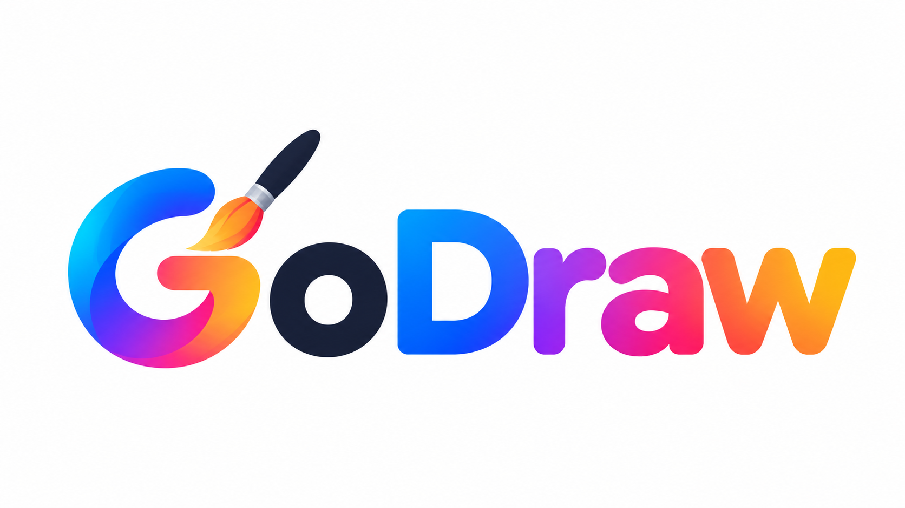

<p align="center"></p>

# GoDraw — drawing & 2D animation studio for Android

GoDraw is a native Android app (Kotlin + Jetpack Compose) for drawing, painting and 2D animation
on phones and tablets. It combines professional tools — layers, blend modes, masks, a dab-based
brush engine, selections and transforms, frame-by-frame and keyframe animation, audio and video
export — with a beginner-friendly **Simple mode**. It has no AI features, no ads, no watermarks,
and needs no account or internet connection to create artwork.

## Features

| Area | What's implemented |
|---|---|
| Home | New drawing / animation, canvas presets & custom sizes, orientation, background (color/transparent), FPS, templates (comic page, storyboard, flipbook, bouncing ball, pixel art…), recent projects, gallery with thumbnails, search, sort, filter, folders, rename / duplicate / move / delete, `.godraw` import/export, tutorials, plans |
| Drawing engine | Tiled stroke buffer (only touched 256 px tiles are re-uploaded), dab spacing, stabilization (pulled-string + smoothing), pressure → size/opacity with adjustable curve, 13 brush families × 16 variants (208 brushes): pencil, pen, ink, paint, airbrush, watercolor (wet edges), marker, calligraphy (flat nib), texture, charcoal, crayon, spray, pixel; brush settings (size, opacity, flow, hardness, spacing, tip, angle, roundness, texture, scatter, wet edges, blend mode); custom brushes |
| Tools | Brush, pencil, pen, eraser, fill (tolerance, grow, sample all layers), eyedropper (+ long-press), line (15° snap), rectangle, ellipse, polygon/star, text, rectangle & lasso selection, transform (move, scale, rotate, flip, distort), cut/copy/paste, symmetry (vertical, horizontal, four-way, radial), ruler, grid, 2-point perspective guides, undo/redo, zoom/pan/rotate, mirror view |
| Color | HSV wheel, RGB + alpha sliders, HEX, recent colors, built-in & saved palettes |
| Layers | Add, rename, delete, duplicate, reorder (drag), hide, lock, opacity, 17 blend modes, groups, clipping masks, layer masks (paint black/white), merge down, flatten, background layer, transparent layers, static layers for animation, thumbnails |
| Animation | Frames: add, duplicate, delete, move (drag), copy/paste, hold durations, FPS, loop, scrubbing, timeline zoom, multi-select; onion skin (frames before/after, opacity, tint colors); keyframes for position, rotation, scale, opacity with linear, ease, back, step, elastic, bounce and custom Bézier easing; smooth (Catmull-Rom) motion paths; on-canvas auto-key tool; transition presets; audio import, trim, offset, volume, mute, synchronized playback |
| Effects | 35 effects (blur, glow, drop shadow, brightness/contrast, hue/saturation, …, oil paint, halftone, bloom), live preview, selection-aware, apply to one or all frames |
| Saving | Autosave (interval configurable), manual save, saves on background/close, atomic writes with `.bak` recovery, crash cleanup + re-indexing on start, memory-bounded cell cache that spills unsaved cells to disk, full backup & restore |
| Export | PNG, transparent PNG, JPG, GIF (median-cut palette, optional dithering), MP4 (H.264 + AAC audio via MediaCodec/MediaMuxer), PNG sequence; resolution, quality, FPS; Gallery or chosen location; share; progress; success is only reported after the file is verified |
| Plans | Free / Pro / Max from one central config, upgrade screens, comparison table, Google Play Billing (product loading, purchase, pending, acknowledge, restore, upgrade/downgrade, expiry), server verification hook, debug-only simulator |
| UI | Dark (default), Light and Colorful themes, Simple & Advanced workspace modes, phone bottom sheets / tablet side panels, left-handed layout, toolbar customization |
| Languages | English, Hebrew, Arabic, Spanish, French — full RTL support; per-app language picker |

## Plans

All limits live in one place: [`core/src/main/kotlin/com/godraw/core/entitlement/Entitlements.kt`](core/src/main/kotlin/com/godraw/core/entitlement/Entitlements.kt).

| | Free | Pro | Max |
|---|---|---|---|
| Projects | 20 | 100 | Unlimited* |
| Layers / project | 15 | 60 | No limit* |
| Frames / animation | 500 | 2,000 | No limit* |
| FPS | 24 | 30 | 60 |
| Export | 1080p | 1440p (2K) | 2160p (4K) |
| Brushes | 40 | 150 | All 208 |
| Effects | 5 | 25 | All 35 |
| Extras | PNG/JPG/GIF/MP4, onion skin, keyframes, pressure, no watermark | custom brushes, masks, clipping, groups, lasso & distort, advanced easing & transitions, timeline zoom & multi-select, multiple audio clips, PNG sequence, GIF dithering, toolbar customization | custom Bézier easing, smooth motion paths, high-bitrate video, custom accent color |

\*Subject to device storage and memory. When a subscription ends nothing is deleted — existing
projects, layers and frames stay fully editable; only adding beyond the Free limits pauses.

## Architecture

```
core/   Pure Kotlin/JVM (no Android): portable, unit-tested, ready for Kotlin Multiplatform
  entitlement/  Tier, TierLimits, Feature, FeatureGate  ← single source of truth for plans
  model/        ProjectDocument, Layer, Frame, Keyframe, AudioClip, guides, presets, templates
  animation/    Easing (incl. cubic Bézier), KeyframeSampler (Catmull-Rom paths), Transitions
  timeline/     FrameOps (insert/duplicate/delete/move/paste), PlaybackClock
  geometry/     StrokeSmoother, DabSpacer, Symmetry, Guides (ruler/perspective snapping)
  brush/        BrushPreset, BrushCatalog (208 brushes)
  raster/       FloodFill;  effects/  35 pixel effects;  color/  color math & palettes
  history/      UndoStack (count- and memory-bounded)
  gif/          Median-cut quantizer + LZW GIF89a encoder
  audio/        PCM resampling & mixing;  storage/  atomic files, JSON format, .godraw archives

app/    Android (MVVM)
  engine/       DrawingEngine (+ layers/animation/effects), CellStore, SnapshotManager,
                StrokeRenderer, StampFactory, Compositor, CanvasView, Viewport, PlaybackController
  data/         Room (projects, folders), DataStore settings, ProjectRepository, templates
  export/       ExportManager, Mp4Encoder, AudioCodecs
  billing/      BillingConfig, BillingRepository, PurchaseVerifier, EntitlementManager,
                TierSimulator (debug implementation in src/debug, inert one in src/release)
  ui/           Compose screens: home, editor (+ panels), settings, subscription, tutorials, about
```

Project format: each project is a folder with `project.json` (versioned, migratable), one PNG
per layer per frame, imported audio and a thumbnail. A `.godraw` file is that folder zipped.
The `core` module keeps the engine portable for a future iOS/iPadOS version.

## Building

Requirements: JDK 17+, Android SDK (platform 35, build-tools 35), or Android Studio Ladybug+.

```bash
./gradlew :core:test                                   # engine unit tests (plain JVM)
./gradlew :app:testDebugUnitTest :app:testReleaseUnitTest   # Robolectric tests
./gradlew assembleDebug        # app/build/outputs/apk/debug/GoDraw-debug.apk
./gradlew assembleRelease      # app/build/outputs/apk/release/GoDraw-release(-unsigned).apk
./gradlew bundleRelease        # app/build/outputs/bundle/release/GoDraw-release.aab
```

### Release signing

Signing credentials are never committed. Provide them in a git-ignored `keystore.properties`
in the project root:

```properties
storeFile=/absolute/path/to/your-upload-key.jks
storePassword=…
keyAlias=…
keyPassword=…
```

or via the environment variables `GODRAW_KEYSTORE_FILE`, `GODRAW_KEYSTORE_PASSWORD`,
`GODRAW_KEY_ALIAS`, `GODRAW_KEY_PASSWORD`. Without them, release builds are produced
**unsigned** and must be signed before distribution (Play App Signing still needs an upload key).

### Continuous integration

`.github/workflows/android.yml` runs all tests and builds the debug APK, release APK and AAB on
every push, uploading them as the `GoDraw-builds` artifact. To sign release builds in CI, add the
repository secrets `GODRAW_KEYSTORE_BASE64` (base64 of the .jks), `GODRAW_KEYSTORE_PASSWORD`,
`GODRAW_KEY_ALIAS`, `GODRAW_KEY_PASSWORD`, and optionally `GODRAW_VERIFICATION_URL`.

## Google Play Billing setup

1. In Play Console create subscriptions with these IDs (or change them in
   [`BillingConfig.kt`](app/src/main/java/com/godraw/app/billing/BillingConfig.kt)):
   `godraw_pro_monthly`, `godraw_pro_yearly`, `godraw_max_monthly`, `godraw_max_yearly`.
   Prices, offers and trials are configured in Play Console; the app shows whatever Play returns.
2. Deploy a purchase-verification server (below) and build with
   `-Pgodraw.verificationUrl=https://your-server/verify` (or `GODRAW_VERIFICATION_URL`).
3. Until products exist **and** verification is configured, the Plans screen shows an
   "unavailable" state instead of offering purchases. All Free features keep working.

### Purchase verification server contract

`POST <verificationUrl>` with JSON `{"packageName": "...", "productId": "...", "purchaseToken": "..."}`.
The server must call the Google Play Developer API (`purchases.subscriptionsv2.get`) with a
service account and reply:

```json
{"valid": true, "tier": "PRO", "expiryTimeMillis": 1767225600000}
```

`tier` is `PRO` or `MAX`. The app acknowledges a purchase only after a successful verification.
Verified results are cached as hashes of purchase tokens and are honoured offline only while
Google Play still reports the same purchase as owned and before its expiry, so editing local
files cannot unlock premium features.

### Debug subscription simulator

Debug builds show *Settings → Developer* to switch between Free, Pro and Max. The simulator
lives in `src/debug`; release builds compile an inert implementation from `src/release` that can
never grant a tier (verified by `ReleaseSimulatorTest`).

## Localization

Strings live in `app/src/main/res/values*/strings.xml` (`values-iw` Hebrew, `values-ar` Arabic,
`values-es`, `values-fr`). The app declares `supportsRtl` and a `locales_config`; the language can
be chosen in Settings. `core/src/test/.../LocalizationTest.kt` fails the build if a language is
missing a key, has mismatched placeholders, incomplete plurals/arrays or bad escaping. To add a
language, add a `values-xx/strings.xml`, list it in `xml/locales_config.xml` and `AppLanguage`,
and add it to the localization test.

## Privacy

Artwork stays on the device unless the user exports or backs it up. No analytics, ads or
tracking. Network use is limited to Google Play and the developer's verification server.
